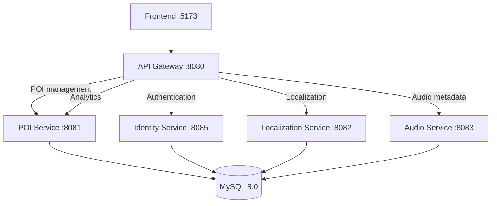

# TÀI LIỆU KỸ THUẬT MEMBER 3: API GATEWAY, AUDIO SERVICE VÀ HẠ TẦNG TRIỂN KHAI


## 1. Tổng quan và phạm vi phụ trách


Member 3 phụ trách tích hợp hệ thống, xây dựng API Gateway, Audio Service và hạ tầng triển khai Docker cho dự án HoiAnGuide – hệ thống thuyết minh du lịch đa ngôn ngữ.


Các thành phần chính:


- **API Gateway (`api-gateway`):** Điểm tiếp nhận request từ frontend, định tuyến đến các backend service và cấu hình CORS.

- **Audio Service (`audio-service`):** Quản lý metadata các bản ghi âm thanh theo POI và ngôn ngữ, cung cấp API CRUD và kiểm soát quyền truy cập.

- **Docker Infrastructure:** Đóng gói các service, cấu hình mạng nội bộ, MySQL, biến môi trường và persistent volume.

- **System Integration:** Kết nối Identity, POI, Localization, Audio và Frontend trong môi trường Docker Compose.


## 2. Kiến trúc hệ thống


### 2.1. Sơ đồ thành phần





### 2.2. Sơ đồ triển khai Docker Compose


Hệ thống gồm 7 container:


| Container | Vai trò | Port |

|---|---|---|

| mysql-db | Cơ sở dữ liệu MySQL | Host 3307, container 3306 |

| identity-service | Xác thực và quản lý tài khoản | 8085 |

| poi-service | Quản lý địa điểm du lịch | 8081 |

| localization-service | Quản lý bản dịch | 8082 |

| audio-service | Quản lý metadata âm thanh | 8083 |

| api-gateway | Cổng API tập trung | 8080 |

| frontend | Giao diện người dùng | Host 5173, container 80 |


Các backend service kết nối với MySQL thông qua mạng Docker nội bộ. Dữ liệu MySQL được lưu trong volume `mysql_data`.


## 3. API Gateway


### 3.1. Cấu hình định tuyến


Gateway sử dụng Spring Cloud Gateway WebFlux.


| Service | Destination | Path predicate |

|---|---|---|

| Identity | identity-service:8085 | `/api/v1/auth/**` |

| POI | poi-service:8081 | `/api/pois/**`, `/api/admin/pois/**` |

| Analytics | poi-service:8081 | `/api/analytics/**` |

| Localization | localization-service:8082 | `/api/localizations/**` |

| Audio | audio-service:8083 | `/api/audio/**` |


Gateway lắng nghe tại port 8080.


### 3.2. CORS


Gateway cấu hình CORS cho các phương thức:


- GET

- POST

- PUT

- DELETE

- OPTIONS


Các origin được cho phép được khai báo trong `application.yml`. Khi triển khai môi trường mới, cần cập nhật danh sách origin tương ứng.


### 3.3. Health check


Gateway cung cấp Spring Boot Actuator với các endpoint được cấu hình:


- `/actuator/health`

- `/actuator/info`

- `/actuator/gateway`


Có thể kiểm tra trạng thái Gateway bằng:


```powershell

Invoke-RestMethod http://localhost:8080/actuator/health

```


## 4. Audio Service


### 4.1. Chức năng


Audio Service quản lý metadata âm thanh gắn với POI và ngôn ngữ.


Các chức năng đã triển khai:


- Truy vấn bản ghi âm thanh theo ID.

- Truy vấn danh sách âm thanh theo POI.

- Truy vấn âm thanh theo POI và ngôn ngữ.

- Tạo metadata âm thanh.

- Cập nhật metadata âm thanh.

- Xóa bản ghi âm thanh.


Lưu ý: Phiên bản hiện tại xác nhận chức năng quản lý metadata CRUD. Chưa xác nhận tích hợp TTS engine để tự động sinh file âm thanh.


### 4.2. API


Base path: `/api/audio`


| Method | Endpoint | Mô tả |

|---|---|---|

| GET | `/api/audio/{id}` | Lấy bản ghi theo ID |

| GET | `/api/audio?poiId={id}` | Lấy danh sách theo POI |

| GET | `/api/audio?poiId={id}&lang={lang}` | Lấy theo POI và ngôn ngữ |

| GET | `/api/audio/poi/{poiId}` | Lấy danh sách audio của POI |

| POST | `/api/audio` | Tạo bản ghi |

| PUT | `/api/audio/{id}` | Cập nhật bản ghi |

| DELETE | `/api/audio/{id}` | Xóa bản ghi |


### 4.3. Phân quyền


Các endpoint được bảo vệ theo JWT và vai trò người dùng:


| Phương thức | Quyền |

|---|---|

| GET | Public |

| POST | ADMIN |

| PUT | ADMIN |

| DELETE | ADMIN |


Các thao tác ghi dữ liệu cần JWT hợp lệ và quyền ADMIN.


### 4.4. Quan hệ dữ liệu


Audio Service sử dụng database `audio_db`.


Thông tin kết nối:


- Database: `audio_db`

- Username: `audio_app`

- Host nội bộ: `mysql-db`

- Port: `3306`


Thông tin mật khẩu được truyền qua biến môi trường, không lưu trực tiếp trong mã nguồn.


## 5. Database và hạ tầng


### 5.1. Các database


MySQL 8.0 quản lý bốn database:


| Database | Service sử dụng |

|---|---|

| identity_db | Identity Service |

| poi_db | POI Service |

| localization_db | Localization Service |

| audio_db | Audio Service |


### 5.2. Docker volume


Volume `mysql_data` được sử dụng để duy trì dữ liệu MySQL khi container được khởi động lại.


### 5.3. Health check


MySQL có healthcheck sử dụng `mysqladmin ping`. Các service phụ thuộc MySQL được cấu hình chờ database ở trạng thái healthy trước khi khởi động.


### 5.4. Biến môi trường


Các biến môi trường quan trọng:


- `MYSQL_ROOT_PASSWORD`

- `IDENTITY_DB_PASSWORD`

- `POI_DB_PASSWORD`

- `LOCALIZATION_DB_PASSWORD`

- `AUDIO_DB_PASSWORD`

- `JWT_SECRET`

- `JWT_EXPIRATION_MS`

- `FRONTEND_BIND`


Các giá trị bí mật phải được khai báo trong file `.env` tại môi trường triển khai. Không commit file `.env` lên Git.


## 6. Hướng dẫn khởi chạy


### 6.1. Chuẩn bị


Yêu cầu:


- Docker Desktop.

- Docker Compose.

- Git.


Tạo file `.env` từ `.env.example` và điền các biến môi trường cần thiết.


### 6.2. Kiểm tra cấu hình


```powershell

docker compose config --quiet

```


### 6.3. Build các image


```powershell

docker compose build

```


### 6.4. Khởi chạy hệ thống


```powershell

docker compose up -d

```


### 6.5. Kiểm tra container


```powershell

docker compose ps

```


### 6.6. Xem log


```powershell

docker compose logs --tail=100 api-gateway

docker compose logs --tail=100 audio-service

```


### 6.7. Dừng hệ thống


```powershell

docker compose down

```


Lệnh trên không xóa volume dữ liệu MySQL. Không sử dụng `docker compose down -v` nếu cần giữ dữ liệu.


## 7. Kiểm thử và xác minh


Các hạng mục đã được kiểm tra trong quá trình tích hợp:


- Build thành công các module backend.

- 44/44 test hiện có của Identity, POI và Localization thành công.

- Gateway khởi động và health check trả về trạng thái UP.

- Docker Compose build và khởi chạy các container.

- MySQL đạt trạng thái healthy.

- Audio API hỗ trợ truy vấn và CRUD metadata.

- Request ghi dữ liệu không có JWT bị từ chối.

- Quyền ADMIN được sử dụng cho các thao tác ghi dữ liệu.


Các nội dung chưa được xác nhận hoàn chỉnh cần tiếp tục kiểm thử:


- Phát audio thực tế từ file âm thanh hợp lệ.

- Tích hợp TTS tự động.

- Kiểm thử toàn bộ luồng frontend trên môi trường triển khai sạch.

- Kiểm thử đầy đủ GPS, QR, bản đồ và các ngôn ngữ theo yêu cầu nghiệm thu.


## 8. Giới hạn và hướng phát triển


Các hướng phát triển tiếp theo:


- Tích hợp TTS engine để tự động tạo file thuyết minh.

- Bổ sung cơ chế lưu trữ và quản lý file âm thanh thực tế.

- Xây dựng cache audio nếu cần tối ưu hiệu năng.

- Bổ sung kiểm thử tích hợp giữa các service.

- Hoàn thiện giám sát và logging trong môi trường triển khai.


---


**Tài liệu thuộc phạm vi kỹ thuật Member 3 – Dự án HoiAnGuide, Nhóm 10.**
